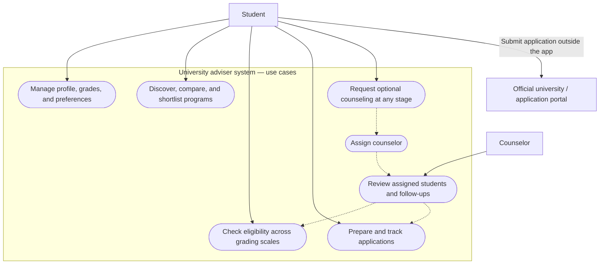
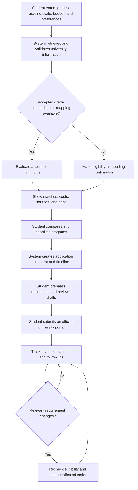
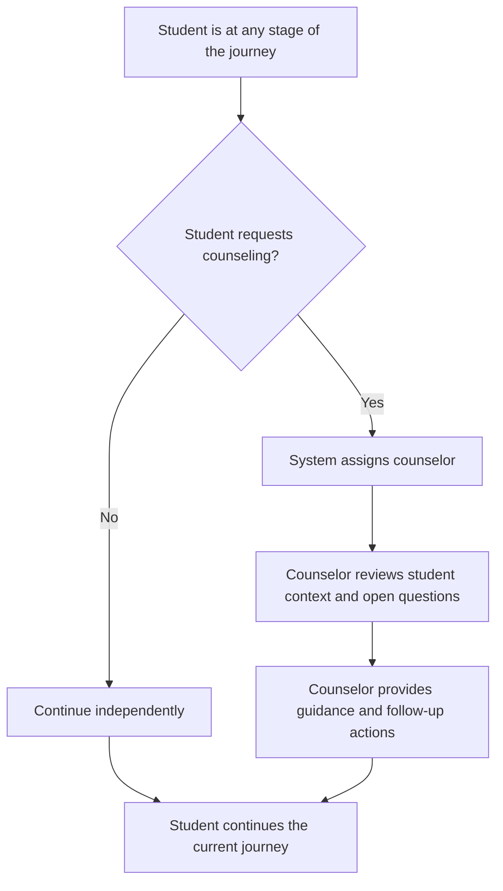

# University Adviser — Actors and Workflow Decisions

Date: October 24, 2026  
Status: Confirmed product decisions and preliminary diagrams  
Audience: Claude implementing the application  
Companion: preliminary-requirements.md

## 1. Confirmed decisions

1. Counseling is optional. Students can discover programs, prepare applications, and track progress independently.
2. Students can request counseling at any stage, including early exploration, profile entry, grade-equivalency uncertainty, shortlisting, preparation, and post-submission tracking. Do not require a shortlist or application plan before allowing a request.
3. When a student requests counseling, the system assigns a counselor. The student does not need to select or invite one. This replaces the earlier suggestion of student-invited counselors.
4. The app helps students prepare and track applications. Students submit applications themselves through official university/application portals.
5. Indonesian grades and destination GPA requirements may use different scales. Use documented, applicable university-accepted equivalencies or direct Indonesian qualification requirements. If no defensible mapping exists, show “Needs confirmation”; do not fabricate a conversion or admission guarantee.
6. Uncertain grade equivalency does not block browsing or shortlisting. Optional counseling can help address uncertainty but must not silently turn an unsupported mapping into an official result.

## 2. Actors and system boundary

| Actor | Responsibilities |
| --- | --- |
| Student | Enter profile, grades, and preferences; explore matches; compare and shortlist programs; prepare and track applications; request counseling at any stage. |
| Counselor | Review assigned students, help resolve uncertain requirements, review readiness, and manage follow-up tasks. |
| University / application portal | Publish admission information and receive student submissions outside this application. |

For the use case diagram, the system boundary includes the student web app and the Atlassian counselor component. AI agents perform work inside this system; they are not additional human actors. Sponsor services are implementation dependencies, not separate student-facing use cases.

University websites and application portals remain external. The diagram below uses Mermaid flowchart notation to represent use cases, rather than claiming to be a formal UML use-case diagram.

## 3. Use case diagram

## 4. Main workflow

Counseling is a parallel, optional support path available throughout the journey. It is not a mandatory gate between creating an application plan and preparing documents. The separate counseling workflow in section 5 applies to every stage below.

The monitoring loop represents checks on relevant events or a future defined schedule, not continuous requests. Polling frequency, change-detection sources, and notification mechanisms remain implementation decisions.

## 5. Optional counseling workflow — available at any stage

Examples of early requests include help choosing countries or majors, understanding the budget, entering school results, or resolving an uncertain GPA mapping. Later requests may concern shortlisting, missing documents, application readiness, or follow-ups after submission.

The diagrams do not require a particular communication medium. Chat, calls, appointment booking, notifications, and response-time promises have not been decided.

## 6. Use case responsibilities

| Use case | Student | Counselor | System |
| --- | --- | --- | --- |
| Complete profile | Enter and correct information | Review when authorized and assigned | Persist profile and identify missing context |
| Discover programs | Explore recommendations | Offer guidance | Retrieve sources and explain matches |
| Check eligibility | Review results and gaps | Help resolve uncertainty | Identify scales, apply supported mappings, flag unknowns |
| Compare and shortlist | Choose programs | Advise | Present comparable sourced information |
| Request counseling | Request at any stage | Receive assigned work | Assign a counselor |
| Prepare application | Provide information, prepare documents, review drafts | Review readiness and follow-ups | Produce sourced checklist and timeline |
| Submit application | Submit through external portal | Provide optional guidance | Link to official portal; track status recorded in the app |
| Monitor changes | Review relevant updates | Act on affected assigned cases | Identify changes, re-evaluate affected records, update tasks |

## 7. Counselor assignment — undecided rules

Only system assignment is confirmed. Claude must not present the following as agreed behavior:

- Assignment algorithm: availability, capacity, language, destination expertise, or school affiliation.
- What happens when no counselor is available.
- Counselor acceptance/rejection, reassignment, and cancellation.
- Whether a student retains the same counselor across all applications.
- Counselor onboarding, verification, and any administrative role.
- Counseling payment, service levels, and operating hours.
- Exact consent and data-access controls, including any sensitive documents.

Propose a minimal workable policy before implementing counselor allocation. Avoid making a student’s independent journey depend on counselor availability.

## 8. Implementation guidance for Claude

- Make counseling accessible throughout the relevant student screens; exact placement and copy can be designed during UI work.
- Preserve current profile, stage, selected programs, and unresolved questions when entering the counseling path; do not force students to restart intake.
- Keep the core student journey independent of the counselor workflow.
- Use the Atlassian Forge component for counselor workload and follow-up coordination, consistent with the preliminary requirements. It does not replace the student-facing application.
- University requirements and counselor advice must remain distinguishable. Store sources and explain uncertainty.
- Do not add autonomous application submission as an implied consequence of using agents.
- Treat the confirmed decisions in this file as authoritative where earlier conversational suggestions differ. Other details in preliminary-requirements.md continue to apply.

## 9. Acceptance checklist

- [ ] A student can complete the core journey without a counselor.
- [ ] A student can request counseling before selecting or shortlisting any university.
- [ ] Counseling can also be requested during eligibility checking, preparation, and tracking.
- [ ] The system assigns the counselor; no student invitation/selection is required.
- [ ] Counseling does not discard the student’s current context or progress.
- [ ] Unknown grade equivalencies remain explicitly uncertain until supported by evidence.
- [ ] The student submits through the official external portal.
- [ ] Counselor allocation rules still marked undecided are resolved explicitly before implementation.
