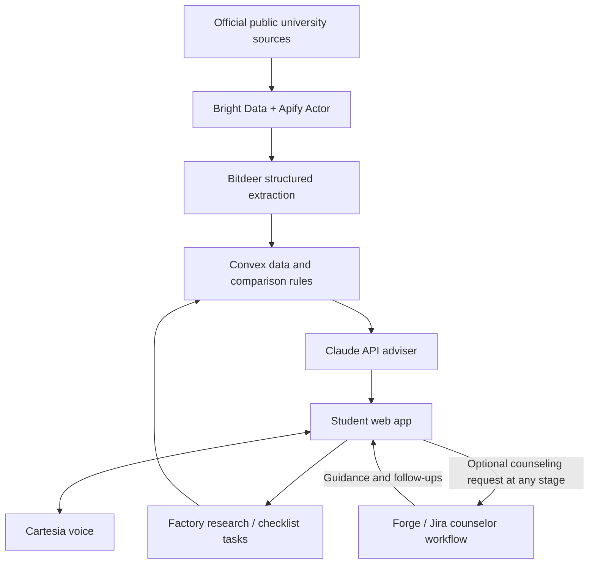

# University Adviser — Systems, Technologies, and Award Requirements

Date: October 24, 2026  
Status: Preliminary implementation and award checklist  
Audience: Claude implementing the project

Companion files:
- preliminary-requirements.md — product scope, implementation sequence, and accounts.
- actors-and-workflow-decisions.md — confirmed actors, optional counseling at any stage, system-assigned counselors, and workflow diagrams.

## 1. Purpose and rule status

Build a web application helping Indonesian high school students discover overseas universities, compare affordability and preferences, map their school results to university academic requirements, and prepare/track applications.

Claude does the technical implementation. The user creates accounts, completes required verification, enters credentials securely, reviews the application, and records the browser demo. Any manual design/note-taking actions must be identified and explained; do not assume coding alone completes process-based sponsor requirements.

This document maps the agreed technology scope to the sponsor challenge descriptions supplied in the conversation. It distinguishes stated requirements from our proposed implementation. A working integration does not guarantee eligibility or an award. Before submission, confirm current official rules, multiple-track entry/winning permissions, participant eligibility, deadlines, and required submission fields. Full Convex eligibility rules have not been supplied.

Do not add technologies solely as decorative integrations. Every claimed sponsor contribution must be real, meaningful, traceable, and demonstrated.

## 2. Agreed technology scope

| System / technology | Role in our project | Build timing |
| --- | --- | --- |
| Web frontend | Student intake, discovery, comparison, shortlist, application workspace, voice interface | Core; framework and hosting TBD |
| Convex | Primary backend and persistent student/program/application data | From the start |
| Bright Data | Discover official sources and retrieve live public university information | Core data pipeline |
| Apify | Reusable admissions collection Actor and repeatable collection workflow | Core data pipeline |
| Bitdeer AI Model Studio | Extract structured requirements, tuition, and deadlines from collected content | Core data pipeline |
| Anthropic / Claude API | Evidence-grounded advising, match explanations, application plans, and reviewed drafts | Core advising |
| Factory Droid SDK | Bounded, triggered research/checklist work within the running application | After core flow |
| Atlassian Forge / Jira | Counselor workload coordination, tasks, and follow-ups | After core student flow |
| Cartesia | Voice intake and discussion of matches | After core app works |
| Figma | Prototyping, iteration, handoff evidence, and required Slides submission | Start during design |
| Mana | Actual planning/prototyping/building/debugging contribution | During development |
| Notability | Actual research notes, sketches, decisions, and idea evolution | During development |
| GitHub | Source repository and reproducible handoff | From the start |
| Microsoft award | Evaluation target for the complete useful AI agent; no Azure requirement stated in supplied criteria | Demonstrate at completion |

Confluence is optional. Meta and Spacetime are excluded from the current agreed scope. Fetch.ai, CREAO, Coinbase, and other unselected sponsors are not implied requirements.

## 3. System responsibilities and data flow

Proposed division, subject to a small technical validation before implementation:

1. Bright Data finds/retrieves public official university sources.
2. The Apify Actor coordinates repeatable collection and produces source records, with a genuine operational role beyond forwarding a request.
3. Bitdeer turns source content into validated structured records, retaining original evidence.
4. Convex persists records, student profiles, shortlist, application state, and provenance.
5. Explicit rules compare budgets and academic requirements; university-approved grade equivalencies handle different grading scales. AI must not invent conversion formulas.
6. Claude API explains results and helps prepare application plans/drafts from verified information.
7. Factory executes bounded triggered research or checklist tasks and exposes its progress/results.
8. Forge/Jira supports counselor work when counseling is requested; the system assigns the counselor.
9. Cartesia supplies a central voice interaction alongside the student web experience.

This is a logical responsibility diagram, not a finalized network/deployment design. Claude must choose supported APIs and authentication patterns; arrows do not promise an existing direct connector between vendors.

## 4. Sponsor qualification and evidence

### 4.1 Anthropic

**Supplied requirements/judging emphasis**
- Serve a named, specific community; “students” alone is too broad.
- Address a real problem the team has experienced or investigated with affected people.
- Deliver a usable working product, rather than a broad unfinished demo.
- Use Claude thoughtfully for a meaningful part of the solution and understand potential harms/failures for users.

**Our implementation**
- Community: Indonesian high school students preparing undergraduate applications abroad; initial destinations still TBD.
- Claude API provides sourced advising, explains eligibility/affordability gaps, and drafts application plans for review.
- Preserve uncertainty around different grading scales, unpublished requirements, and admission chances.

**Evidence / completion**
- [ ] Actual student problem evidence; do not fabricate interviews.
- [ ] End-to-end student flow with meaningful Claude API calls.
- [ ] Sources, uncertainties, and model failure cases documented.
- [ ] README explains Claude’s role separately from Claude’s use to write code.

**Listed prize:** $5,000 Claude credits + 1 year Claude Max 20x + office hours.

### 4.2 Bright Data

**Supplied requirements**
- Live public web data must be essential: removing it would prevent the core product from working.
- Run a live demo with real website results and turn raw information into useful output.
- Handle real conditions including blocks, slow responses, and empty results.
- Disqualifying behavior listed: scraping behind login/paywalls, collecting non-public personal data, mocked/hardcoded demo data, or mentioning Bright Data only in the README.
- Thoughtful tool selection and a clear two-minute story are favored; the supplied text does not establish a separate formal video limit.

**Our implementation**
- Proposed SERP API for source discovery and Web Unlocker for public official-page retrieval.
- Refresh tuition, scholarship, deadline, or admission information and show how it changes advice.

**Evidence / completion**
- [ ] Actual Bright Data calls are part of the live research path.
- [ ] Show retrieved source URL, time, extracted result, and product consequence.
- [ ] Demonstrate graceful failed/empty retrieval handling.
- [ ] No fake live results; fictional student profiles are distinct from real university data.

**Listed prizes:** 1st $1,500 credits + $500 Amazon card; 2nd $1,000 credits + $350 Amazon card; 3rd $500 credits + $250 Amazon card.

### 4.3 Apify — Best Use and Best Actor

**Supplied requirements**
- Use Apify meaningfully; judges consider product quality and other unspecified criteria.
- Separate Best Actor award is for building an Actor for this event.
- Detailed Best Actor publication/submission conditions still need confirmation.

**Our implementation**
- Build a reusable university-admissions Actor that collects source content and returns a structured source package for extraction.
- Expose sensible configurable inputs, source URLs, errors, timestamps, and repeatable runs.
- Apify’s contribution must be more than a wrapper added to qualify.

**Evidence / completion**
- [ ] Working Actor built for the event, with source and usage instructions.
- [ ] Actor run and output demonstrably consumed by the app.
- [ ] Verify whether/how it must be published and separately entered for Best Actor.
- [ ] README explains the distinction between Apify and Bright Data work.

**Listed prizes:** Best Use: $2,000 / $1,000 / $800 / $400 / $400. Best Actor: $400. Combined stated total: $5,000.

### 4.4 Convex

**Known from supplied material**
- Track: Best Use of Convex; winning team receives $5,000 cash.
- The description presents a reactive backend platform, but detailed eligibility/judging rules were not supplied. Our integration alone must not be called confirmed qualification.

**Our implementation**
- Main backend for student profiles, normalized university data, source provenance, shortlists, application tasks, and progress.

**Evidence / completion**
- [ ] Fetch and review complete official track requirements.
- [ ] Show persistent data and meaningful backend operations in the working app.
- [ ] Document schema, access controls, and actual use of Convex.

### 4.5 Bitdeer AI Model Studio

**Supplied requirements**
- Build a working AI-powered project using Model Studio.
- Clearly demonstrate its use and submit a brief description plus demo/presentation.
- Judging: innovation/creativity 30%; technical implementation 30%; Model Studio use 20%; impact/presentation 20%.

**Our implementation**
- Use hosted model inference to structure admissions requirements, costs, and deadlines from collected content.
- Validate extracted fields; retain evidence and flag unknown/conflicting information.

**Evidence / completion**
- [ ] Actual Model Studio inference in the product flow.
- [ ] Show source text → structured fields → saved university record.
- [ ] Include concise implementation and limitation descriptions.

**Listed prizes:** 1st $500 Model Studio credits + four gaming mice; 2nd $200 credits + one shared LEGO Technic set.

### 4.6 Factory Droid SDK

**Supplied requirements**
- Use TypeScript or Python Droid SDK meaningfully.
- Droid must do real work in the running product, not only help write code.
- README must explain where/how it is used.
- Strong entries have a designed trigger, thoughtful permission/safety boundaries, and visible plans, steps, diffs, or results.
- Weak entries: superficial chatbot wrapper, slide-only demo, or no clear evidence of agent work.

**Our implementation**
- A student selects a program or requests updated research; Droid performs bounded research and produces a sourced checklist or proposed changes.
- Keep different-grade-scale decisions grounded in accepted policies, not autonomous invented conversion.

**Evidence / completion**
- [ ] Show trigger, agent execution, result, and product update.
- [ ] Document tool permissions, failure handling, and approval boundaries.
- [ ] Include README explanation and inspectable execution history.

**Listed prize:** $2,000 cash + Factory credits + swag.

### 4.7 Cartesia

**Supplied requirements**
- Build a useful voice experience with Cartesia; voice must be core, not a demo-only add-on.
- Submit a working demo, two-minute demo-first presentation covering a complete flow, short README with setup/features/limitations, and source access per event rules.
- No API keys/secrets in the repository.
- Judging: problem/originality, Cartesia use, execution, impact/responsibility — 25% each.

**Our implementation**
- A voice adviser gathers student preferences through follow-up questions and discusses sourced matches.
- Confirm Indonesian language quality/support before promising the experience. Decide how speech input and output will be implemented from supported APIs.
- Voice can complete a meaningful task; it is not merely reading a static answer aloud.

**Evidence / completion**
- [ ] Complete voice intake or match-discussion flow.
- [ ] Test interruption, microphone permission, unclear speech, errors, and text fallback.
- [ ] Prepare the requested two-minute presentation separately from three-minute videos if needed.
- [ ] README and source access complete.

**Listed prize:** Meta glasses, explicitly still TBD in supplied material.

### 4.8 Atlassian — Track 1: Agents that do the work

**Supplied requirements**
- Build a Forge app for one or more Atlassian products; Jira/Confluence recommended.
- Choose one of the two challenge tracks. We choose Track 1, autonomous execution of real collaborative team work.
- Submit code repository link and demo video no longer than three minutes.
- Judging: creativity/quality, usefulness/impact, technical implementation and operational robustness.
- Strong submissions reduce team work and address a prevalent problem.

**Our implementation**
- Forge app installed in a Jira demo site for counselor workload.
- Counseling is optional and requestable at any stage. System assigns the counselor; the allocation algorithm remains undecided.
- Agent identifies missing documents or changed requirements, creates/updates follow-up tasks, coordinates ownership, and summarizes urgent actions.
- Keep approval/audit controls, but do not claim entry into both Atlassian tracks without checking rules.
- Confluence is optional and not needed merely to claim participation.

**Evidence / completion**
- [ ] Real Forge app installed and functioning in Jira.
- [ ] Show agent decisions/actions and concrete counselor workload reduction.
- [ ] Show source/context, action history, and review boundaries.
- [ ] Three-minute maximum video and repository link.

**Setup specified in challenge:** Node.js 22/24; Forge CLI 14+; Forge-scoped API token; demo site; register/deploy/install app. Claude handles CLI work; user handles account access/verification.

**Listed prize:** Winners each receive AirPods Max headphones.

### 4.9 Figma — Idea To Demo

**Supplied requirements**
- Take an idea to a working demo during the hackathon, using tools intentionally.
- Show actual Figma use and iteration; Figma need not handle every stage or generate all code.
- Be Education verified; submitted Figma files must be accessible to “Anyone.”
- Deliver: demo video ≤3 minutes; stage log ≤200 words per stage; required Figma Slides demonstrating work/workflow.
- Slides must include the stage log/tool rationale, demo video, embedded Make and/or prototype files, and working code/repository link.

**Stage log must cover** ideation, prototyping, handoff, and code generation, identifying which stages used Figma. For each stage record tools/reasons, approximate minutes, effectiveness 1–5, and how output entered the final project. Include actual rework, dead ends, and abandoned tools; do not invent a neat linear history.

**Our implementation**
- Prototype student intake, program comparison, and application checklist.
- Review/test and revise the prototype; hand actual artifacts to Claude for implementation.
- Use other tools honestly in stages where they did the work.

**Evidence / completion**
- [ ] Genuine Education verification completed; resolve eligibility with sponsor if not eligible.
- [ ] Working prototype with visible, meaningful iteration.
- [ ] Stage log within word limits.
- [ ] Required Figma Slides and embeds/links.
- [ ] Public accessibility checked and video within limit.

**Listed prize:** Amazon gift cards, amount unspecified, plus a session with Figma Early Career Recruiting Team to be scheduled.

### 4.10 Mana.space

**Supplied requirements**
- Meaningfully use Mana while building.
- Explain where it helped and link one or two public Mana pages/chats for judges.
- Show one moment in the demo where Mana changed the build or improved speed.
- Judging: meaningful use 30%; usefulness 25%; originality 25%; execution 20%.
- Bonus up to +10: project lives in Mana as an app/agent a judge can open and use.

**Our implementation**
- Use Mana for a real planning, prototype, or debugging task and preserve the output used in the final project.
- Hosting inside Mana is optional bonus scope, not agreed primary architecture; do not duplicate the application solely to claim it.

**Evidence / completion**
- [ ] Specific genuine development contribution.
- [ ] One or two public pages/chats and a concrete demonstration moment.
- [ ] README/submission explains how the output affected the project.

**Listed prize:** $5,000.

### 4.11 Notability

**Supplied judging emphasis**
- Process: idea evolution from early sketch to final build.
- Detail: notes clear enough for someone else to follow the thinking.
- Feature use: thoughtful use of features such as handwriting, audio, diagrams, PDFs, and Smart Notes.
- Relevance: Notability genuinely contributes, rather than being added after the fact.
- Supplied wording does not establish that every listed feature or a paid Pro subscription is mandatory.

**Our implementation**
- Keep actual student research notes, flow sketches, tradeoffs, and design decisions during development.
- Use relevant available features intentionally. A final Markdown export imported only at submission is not evidence of genuine development use.

**Evidence / completion**
- [ ] Notes show chronological idea evolution and decisions.
- [ ] Meaningful feature use and contribution are demonstrable.
- [ ] Confirm required sharing/export/submission format with sponsor; not supplied.

**Listed prize:** One year Notability Pro + exclusive company merchandise.

### 4.12 Microsoft — Grand Prize and Customer Impact

**Supplied requirements/judging**
- Build a production-minded AI agent solving a meaningful finance, productivity, healthcare, or other high-impact problem.
- Judging: customer understanding, measurable usefulness, prototype-to-production path, responsible design, and end-to-end functionality.
- Customer Impact Award lists the same criteria.
- Supplied criteria do not explicitly require Azure, Microsoft APIs, or a separate Microsoft account.

**Our implementation**
- Demonstrate a useful student journey plus counselor workload automation, with sourced facts, grade-equivalency uncertainty handling, and real follow-up tasks.
- Define measurable outcomes, such as time to create a sourced shortlist, verified information completeness, or counselor actions saved. Measure rather than invent results.

**Evidence / completion**
- [ ] Clear customer problem and actual validation where feasible.
- [ ] Complete working flow and measured benefit.
- [ ] Responsible-design choices and production path documented.
- [ ] Confirm final entry mechanics and whether both categories require separate selection.

**Listed prizes:** Grand Prize: Surface laptop per winning team member, remote FDE team tech-talk presentation, and senior FDE mentorship. Customer Impact: remote presentation and senior FDE mentorship.

## 5. Account and credential checklist

Use hackathon offers before paying. Exact permissions depend on implemented endpoints; do not request blanket administrator access for runtime code.

| Service | User setup | Claude setup |
| --- | --- | --- |
| Anthropic | Console account, project workspace, regular API key, credits | Server API integration and usage controls |
| Convex | Account/project access | Dev deployment, schema, auth/access rules, scoped deployment credentials if needed |
| Bright Data | Account, credits, product zones, runtime User API key | Product requests, zone configuration validation, retries |
| Apify | Account, Actor development access, token access | Actor build and separate development/runtime permissions |
| Bitdeer | Model Studio account, inference key/credits | Inference integration and output validation |
| Factory | Account and Droid SDK/API access | SDK authentication, triggers, bounded tools, visible execution |
| Cartesia | Developer account and server API key | Speech integration, supported browser authentication, language tests |
| Atlassian | Account and Forge-scoped token with recommended login scopes | CLI, demo site, app registration/deployment/install, manifest scopes |
| Figma | Account and Education verification | Prototype/handoff/Slides work through available tools; request user clicks if necessary |
| Mana | Account and ability to share selected pages/chats | Real documented development contribution |
| Notability | Account and access to relevant features | Real notes/artifacts through supported workflow; identify manual steps |
| GitHub | Existing account/repository access | Source management and submission-ready repository |

Secret values belong in local/hosted secret settings, never chat, public pages, source control, or recording footage. Public workflow evidence must omit secrets and personal student data.

## 6. Demo and submission strategy

Core story: student enters profile → system researches official information → maps Indonesian grades to the destination scale or flags uncertainty → presents three sourced matches → student shortlists a program → agent prepares a checklist → optional system-assigned counselor receives real follow-up work.

Counseling can be requested before shortlisting, during grade checks, or later. The demo should not suggest it is available only after an application plan exists. Application submission itself remains on official external portals.

- Prepare a three-minute main recording for Figma/Atlassian where appropriate.
- Prepare Cartesia’s requested two-minute demo-first presentation.
- Confirm other sponsors' video limits and whether one recording may be reused; these are not universally established.
- Do not cram every integration into a single short video. Prepare sponsor-specific evidence and concise variants.
- Make browser flows ready for the user, with exact clicks/narration and working sample profiles.
- Use real live public university data where required; label fictional student profiles and controlled test events.

## 7. Definition of done for award preparation

- [ ] Event participant and multi-track rules verified.
- [ ] Full missing sponsor rules, particularly Convex, reviewed.
- [ ] Actual contribution from every claimed technology is implemented and evidenced.
- [ ] Sponsor use is documented separately from tools used merely to write code.
- [ ] Data collection, extraction, advising, and agent roles are distinct and technically justified.
- [ ] GPA/grade mapping is sourced, scale-aware, and explicit about uncertainty.
- [ ] Optional counseling works throughout the journey; assignment rules finalized.
- [ ] Required prototypes, process notes, public links, Slides, README, and repository access are complete.
- [ ] Video limits and submission fields checked per sponsor.
- [ ] API failures, costs, permissions, secrets, and demo reset flow tested.
- [ ] User can record the app without programming or exposing credentials.

## 8. Reference links

These links support implementation; event-specific rules supplied by organizers remain controlling.

- Anthropic: https://platform.claude.com/docs/en/get-api-key
- Convex: https://docs.convex.dev/
- Bright Data: https://docs.brightdata.com/api-reference/authentication
- Apify: https://docs.apify.com/integrations/api
- Factory SDK: https://docs.factory.com/sdk/typescript
- Bitdeer: https://www.bitdeer.ai/
- Cartesia: https://docs.cartesia.ai/get-started/overview
- Forge setup: https://developer.atlassian.com/platform/forge/getting-started/
- Forge starter repository: https://github.com/atlassian-labs/forge-inspired
- Figma Education: https://www.figma.com/education/
- Figma stage-log example supplied by challenge: https://www.figma.com/slides/hViyGFvaHxTBqzYKkaYPho
- Mana: https://www.mana.space/
- Notability: https://notability.com/

Do not interpret this checklist as a promise of an award. Final eligibility and judging belong to the event and sponsors.
