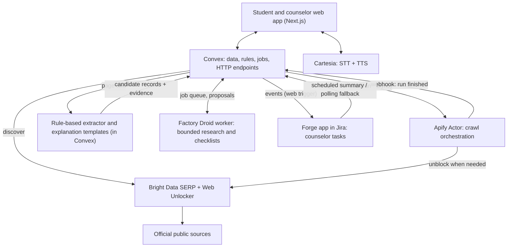
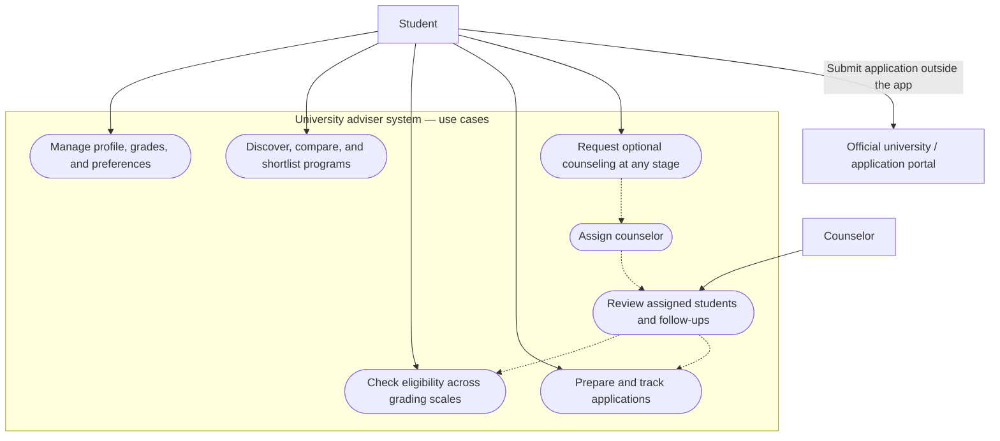
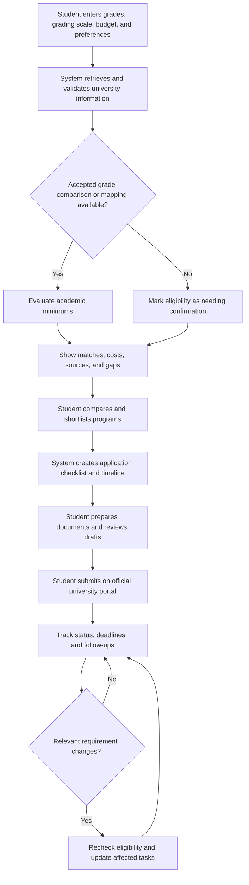
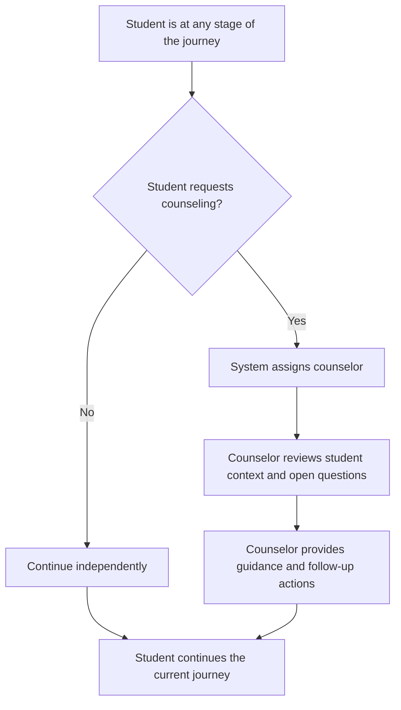

# Langkah (University Adviser) — Consolidated Specification

Product name: **Langkah**, as shown in langkah-polished-screens.html (decided by the user).

Version: 1.0 (draft for review)
Date: October 24, 2026
Status: Specification only. No code exists. No third-party account has been exercised.

Phase: the current phase is specification, approach, design and feasibility. Accounts, keys, Figma access, live checks, and anything that needs the user's accounts are **build-phase** items. They are listed so they are known, but none is needed to complete or review this specification.

## 0. Document control

### 0.1 Authority

This document consolidates and supersedes, for implementation purposes, these files, which remain unchanged as source history:

- archive/preliminary-requirements.md
- archive/additional-requirement.md
- archive/actors-and-workflow-decisions.md (diagrams carried into Appendix A)
- archive/technology-and-award-requirements.md (sponsor table carried into Appendix B, links into Appendix C)
- archive/figma.md
- archive/implementation-spec.md
- archive/decisions-and-stack.md

Normative companions that are not repeated here:

- sponsor-technical-requirements.md — testable requirements derived from the sponsor tracks (IDs AP-, BD-, BT-, CV-, AN-, FD-, AT-, CA-, MS-, FG-, X-).
- award-evidence-plan.md — documentation and process evidence for each sponsor.
- docs/figma-plan.md — the Figma design deliverable: capability status, how the design gets made, files and pages, design system, screens, prototype flows, handoff, Slides.
- docs/design-delta.md — guidance derived from the user's mock: what to keep, what changes, which screens are added. The mock is guidance, not the final design.
- docs/engineering-detail.md — function surface, tables, extraction schema, agent tool contracts, Forge/Jira template, config values, cost and timeline rules, metrics.
- docs/test-demo-setup.md — test strategy, demo data, reset, user setup guide and early live checks.
- docs/devlog.md — the honest development log.
- langkah-polished-screens.html — visual direction only. Its sample data is fictional and must never become product data.

Where this document and an older file disagree, this document wins. Where this document and sponsor-technical-requirements.md disagree, resolve the conflict explicitly and fix both.

### 0.2 Status labels

- **CONFIRMED** — decided by the user.
- **PROPOSED** — recommended default awaiting the user's yes.
- **UNVERIFIED** — a fact about an external service or rule that has not been tested live or checked against official rules.
- **RISK** — a known threat to the plan with a named early check.

### 0.3 Responsibilities

- Claude: design in Figma (if write access is confirmed), code, integrations, tests, deployment preparation, documentation.
- User: accounts, verification (including Figma Education), secure secret entry, design review, real conversations with students and counselors, genuine Notability and Mana use, estimates of minutes and ratings for the stage log, recording the demo.
- Process evidence (tool use, minutes, ratings, iteration history, interviews) is recorded as it actually happens and is never invented or backdated.

## 1. Product

### 1.1 Purpose

A web application that helps Indonesian high school students discover, compare and prepare applications to bachelor's programs at universities in the United States (US) and United Kingdom (GB), and track each application's milestones from research through arrival. AI turns verified university information and student preferences into understandable, sourced recommendations and action plans.

### 1.2 Users

- **Student** (primary): an Indonesian high school student.
- **Counselor** (secondary, optional support): assigned by the system when a student asks for help.
- **Official university or application portal** (external): where students submit applications themselves.

AI agents are not human actors. They are components inside the system.

### 1.3 Named community (for the Microsoft track)

Indonesian high school students preparing undergraduate applications to US and UK universities. "International schools" means overseas universities and their bachelor's programs (assumption from the original requirements, still to be confirmed by the user).

### 1.4 Out of scope

- Guaranteed admission predictions or claims that meeting a published minimum guarantees admission.
- Autonomous submission of applications, payments, or messages as a student or counselor.
- Visa applications and financial underwriting; the app offers planning information and official links only.
- Meta peer networking, SpacetimeDB, destinations other than US and GB (keep the model extensible only).
- A separate administrator dashboard (not approved). Only the minimum configuration needed for the first release.
- Live chat, typing indicators, presence, voice calls and appointments with counselors.
- Features added solely to chase prize tracks.

## 2. Confirmed decisions

| # | Decision | Status |
| --- | --- | --- |
| 1 | Destinations: US and GB only. Country codes `US` and `GB`. | CONFIRMED |
| 2 | Catalog target: all bachelor's programs in those countries, delivered in verified batches with honest coverage (section 4). | CONFIRMED goal; batch PROPOSED |
| 3 | Counseling is optional, requestable at any stage, assigned by the system. Students never select or invite a counselor. | CONFIRMED |
| 4 | Assignment is round robin. | CONFIRMED |
| 5 | Student-counselor communication is asynchronous in-app messages. | CONFIRMED |
| 6 | Students can upload files and explicitly share selected files with the assigned counselor. | CONFIRMED |
| 7 | Agents do as much operational work as possible. Counselors advise. | CONFIRMED |
| 8 | Students submit applications themselves on official portals. | CONFIRMED |
| 9 | All selected sponsor technologies are required parts of the product (or development process) and must be meaningfully used. A custom Apify Actor is mandatory. | CONFIRMED |
| 10 | Demo runs on the user's MacBook or hosted; both must work. | CONFIRMED |
| 11 | Retention is 10 years by default, configurable; student-requested deletion overrides it (section 12.3). | CONFIRMED period; deletion override PROPOSED |
| 12 | Voice: Cartesia `ink-whisper` for Indonesian speech-to-text, `sonic-3.6` for text-to-speech, no translation step. | CONFIRMED |
| 13 | Exchange rates come from a free, sourced service, never from a language model. | CONFIRMED principle; Frankfurter PROPOSED |
| 14 | Indonesian grade equivalency policies are collected by the agent pipeline from official sources; no invented conversions. | CONFIRMED |
| 15 | Setting classification is defined in a configuration file. | CONFIRMED; thresholds PROPOSED |
| 16 | Ranking is deterministic and explainable (section 5.3). | PROPOSED |
| 17 | Stack choices in section 6. | PROPOSED, corrected by vendor documentation research |

## 3. Roles and permissions

| Role | Permitted |
| --- | --- |
| Student | Manage own profile, qualification records, matches, shortlist, applications, tasks, uploads, sharing, counseling requests and messages. Request deletion. |
| Assigned counselor | Read the authorized student context (profile, selected programs, unresolved questions, tasks) and explicitly shared files; send messages; see agent and system updates for that student. |
| Unassigned counselor | No access to any student data. |
| Agent / service identity | Execute bounded operations listed in section 10, under ownership, sharing and source-trust rules, with action history. |

### 3.1 Access matrix

| Data | Student (owner) | Assigned counselor | Other students | Unassigned counselor | Agents |
| --- | --- | --- | --- | --- | --- |
| Profile and grades | read/write | read | none | none | read via narrow queries for assigned jobs |
| Shortlist, applications, tasks | read/write | read | none | none | propose changes only |
| Uploaded files | read/write/delete/share | read only if explicitly shared | none | none | none unless the student authorizes an AI task for a named file |
| Messages | read/write | read/write (own relationship) | none | none | system updates labeled as such |
| Catalog and sources | read | read | read | read | write through ingestion pipeline only |
| Counseling notes | not in first release (no private counselor notes) | | | | |
| Agent run history for a student's application | read | read | none | none | write |

Rules:

- Assignment alone never shares files.
- Sharing with a counselor does not authorize sending the file to any AI vendor (FILE-003).
- Every check happens in server functions; the client is never trusted.

## 4. Catalog scope and coverage

### 4.1 Goal and honesty rule

The goal is all bachelor's programs in the US and GB. The first release delivers verified batches and shows coverage honestly. The app must never claim complete national coverage or present a ranked subset as the full catalog.

### 4.2 Coverage records

For each institution and program the system stores discovery status, ingestion status, last verification time, failures, and which fields are unknown. Internal coverage reports and a user-visible limitation message ("Showing N verified programs from M institutions") are required.

### 4.3 First verified batch (CONFIRMED by the user, 2026-10-24)

Twelve institutions, six per country, and two majors: **Computer Science and Economics** (bachelor's level). Computer Science is the primary demo major; Economics provides the "other majors stay visible" and "Related major" cases. All facts in the table come from research agents reading official pages (some from search summaries) and are UNVERIFIED until the live collection runs; each row is confirmed or corrected by ingestion.

Whether each institution offers a first-year-accessible bachelor's Economics program (and its official page) has not been checked and is part of the first ingestion check. If an institution lacks one, it is recorded as a coverage gap for that major, not silently dropped.

**US**

| Institution | Setting (to be classified by config) | Why it is in the batch |
| --- | --- | --- |
| Penn State (University Park) | College town | Dedicated Indonesia page, rolling after Early Action; CS major gated by GPA after 29–55 credits |
| Michigan State | College town | Indonesia section, Early Action then rolling; confirm the Engineering CS major accepts first-years |
| University of Wisconsin–Madison | Mid-size city | Fixed rounds, non-binding Early Action, Indonesia section |
| University of Illinois Urbana-Champaign | Twin college cities | Fixed rounds, Common App only, no current Indonesia page |
| Northeastern University | Large city | Binding Early Decision I and II, automatic merit awards |
| Dartmouth College | Rural | Binding Early Decision, context-based review of grades, SAT or ACT required |

US reserves: Oregon State, Arizona State, Purdue.

**GB**

| Institution | Setting (to be classified by config) | Why it is in the batch |
| --- | --- | --- |
| University of Exeter | Small city | Indonesia page expressed in A-level/IB terms; Indonesia-specific scholarship |
| University of Sheffield | Large city | Indonesia requirement in Indonesian terms; its own pages conflict on English minimums |
| Lancaster University | Small city, parkland campus | Foundation route required; Indonesia is on its scholarship list |
| University of Manchester | Large city | Highest cost; foundation required for SMA |
| University of Bath | Small historic city | No Indonesia page |
| Loughborough University | Market town | Foundation route through ONCAMPUS; international accommodation guarantee |

GB reserves: Edinburgh and Glasgow (four-year Scottish degrees; Edinburgh's fee and Glasgow's Indonesia requirements were not found).

Findings that shape the product (from the research, to be verified live):

- All twelve use a centralized or shared route for standard first-degree applications (UCAS for GB; Common App, Coalition or the university's own application for US). Direct applications in GB exist only for foundation or pathway programmes, so foundation and pathway routes are first-class `ApplicationRoute` records.
- Most Indonesia pages say the Indonesian secondary diploma alone is not sufficient for direct entry. Only some publish thresholds. No US institution in the batch publishes a conversion, so US academic status will often be "Needs confirmation".
- Tuition and living-cost figures are published on different bases and for different years; several 2027 figures are provisional. All are stored with their period and year and shown with completeness labels.
- Expect the setting rule to place some college towns in the unclassified band; that behavior is intended and is a demo case.
- Taxonomy: Computer Science is Related to software, data and information-systems programs; Economics is Related to business, finance and quantitative programs. Mapping lives in `config/taxonomy.json`.

### 4.4 Program identity (DATA-001)

Separate institution, campus, bachelor's program, intake, admission round and application route. Deduplicate without collapsing distinct campuses, intakes or routes. Decide before claiming coverage how to treat integrated or combined degrees, foundation-entry routes and programs with multiple teaching sites. Store stable identifiers.

## 5. Functional requirements

### 5.1 Student profile (PROF)

**PROF-001 Inputs.**

- Budget: amount, currency, annual or total, and whether it covers tuition only or tuition plus living costs.
- Countries (US, GB), settings (city, countryside).
- Intended majors and acceptable related fields.
- Climate preference: warm, mild, cool, cold, or no preference.
- Intended intake (term and year).
- Indonesian qualification and curriculum (e.g., SMA/SMK, Kurikulum Merdeka, K13, IB, Cambridge), school and year context, grade reporting scale (original minimum and maximum), reported grades, subject-level grades.
- Language evidence per test: score and date, or "not yet taken", or "unknown".
- Any value may be "unknown".

**PROF-002 Updates.** Edits persist without overwriting original grade or document evidence. Edits recompute affected rankings, assessments and proposed tasks, preserving official deadlines and completed action history. Data of different students is isolated.

**PROF-003 Currency.** Retain original published costs and currencies. Conversions require a sourced rate and rate date (section 5.4). Without a rate, show the original currency and an explicit "conversion unavailable" state.

### 5.2 Discovery filters (DISC)

**DISC-001 Country is a hard filter.** Only programs in selected countries are returned. If no country is selected, return no matches and prompt the student to choose at least one. An empty selection never means both.

**DISC-002 Setting is a hard filter.** If city and/or countryside is selected, return only programs whose teaching campus setting matches a selected value. If neither is selected, apply no setting restriction (PROPOSED default). Unknown or unclassified settings never count as a match when a setting filter is active; the count of programs needing classification is shown.

**Classification rule (PROPOSED, configurable).**

1. Geocode the teaching campus address from the official source.
2. Find the nearest settlement within a configured radius in the GeoNames cities dataset (free, attribution required) and read its population.
3. Classify by population against two configured thresholds.

```jsonc
// config/setting.json
{
  "cityMinPopulation": 100000,
  "countrysideMaxPopulation": 50000,
  "settlementSearchRadiusKm": 15,
  "betweenThresholds": "unclassified",   // "unclassified" | "city" | "countryside"
  "overrides": []                         // { campusId, setting, reason, sourceUrl }
}
```

Each classification stores the settlement used, its population, the dataset version and the config version. Programs spanning campuses are classified per campus. Online-only programs are unclassified. The thresholds are placeholders for review, not an official definition.

**DISC-003 Other inputs do not exclude.** Budget, major, climate, grades and language scores affect ranking, explanations and preparation only. A Computer Science preference does not hide other majors. A below-threshold academic result or an over-budget program stays visible.

### 5.3 Ranking (DISC-004, PROPOSED)

Lexicographic ordering on banded outcomes. No weights and no match percentage. Keys, in order, each ordered best to worst:

| Priority | Key | Outcomes |
| --- | --- | --- |
| 1 | Major relevance | Direct, Related, Other, Unknown |
| 2 | Academic status | Meets published minimum, Needs confirmation, Subject gap, Below published minimum |
| 3 | Budget fit | Within budget, Within budget (costs incomplete), Unknown, Slightly over, Over |
| 4 | Climate fit | Match, Partial, Unknown, Mismatch |
| Tie-break | Lower known annual cost, then program name | stable |

Definitions:

- **Major relevance:** each program is classified into an internal taxonomy mapped to CIP (US) and HECoS (GB) codes through a configuration table. Direct = in the student's chosen majors; Related = same broad field in the taxonomy; Other; Unknown if unclassified. Keyword rules over the program name and page title propose the classification with evidence; the mapping table is deterministic.
- **Academic status:** from the grade comparison (section 5.5). Needs confirmation ranks above Below because unknown is not a negative result.
- **Budget fit:** annual comparable cost = tuition + mandatory fees + institution-published living estimate when available, converted with a sourced rate. "Within budget (costs incomplete)" means known costs fit but the living estimate or fees are missing. "Slightly over" means over by no more than a configured percentage (default 15%).
- **Climate fit:** campus climate normals compared to configured bands (section 5.3.1).

Behavior:

- The student can re-sort by cost or academic status. The default order never hides anything.
- Each result shows its band for all four keys, cost completeness, budget gap if calculable, and unresolved information, each with its source.
- A lexicographic order can rank a Direct-major program the student is below the minimum for above a Related-major program they meet. This follows the priority order and is documented in the UI help ("How to read your matches"). Gaps are never shown as a reason the student may not apply.
- The key order, thresholds and bands live in `config/ranking.json` and are unit tested.

#### 5.3.1 Climate (PROPOSED)

Source: Open-Meteo climate API by campus coordinates (free; terms for this use must be checked). Computed normals: mean annual temperature, coldest-month mean, warmest-month mean, annual precipitation. Preference bands in `config/climate.json`. Climate data source and version are stored with each campus. Population density as a separate criterion is replaced by the setting filter.

### 5.4 Costs and currency (DATA-003, PROF-003)

- Store separately: tuition (period and currency), mandatory fees, institution-published housing and living estimates, inclusions and exclusions.
- Use the international-applicant rate and source. Never assume the domestic rate applies.
- Missing living cost means the total is incomplete and is labeled so. It is never filled with an unsourced AI estimate.
- Scholarships are conditional opportunities, never guaranteed deductions.
- Exchange rates: Frankfurter (European Central Bank reference rates, no key) stored with base, quote, rate date and source. The UI states that these are indicative reference rates, not bank rates. Large conversions show the rate date.
- Annual versus total (program-length) comparisons use the program duration from the source; never assume a duration.

### 5.5 Indonesian grade mapping (GRADE)

This is a core, deterministic, versioned rule set. AI retrieves and explains; it never invents conversions.

**GRADE-001 Original record.** Capture original grade, scale (min and max), qualification and curriculum, school and year, and subject results. Never overwrite them with converted values. Never assume all Indonesian schools use one reporting scheme.

**GRADE-002 Comparison method.** In order:

1. If the institution or program publishes requirements for Indonesian qualifications, compare directly, showing the original result and the applicable requirement without inventing a converted GPA.
2. Otherwise apply an equivalency explicitly accepted by the institution and applicable to the student's qualification and intake.
3. A general destination-level estimate may be shown only as an explicitly unofficial estimate that cannot establish eligibility.
4. If no defensible mapping exists, the outcome is Needs confirmation.

Never use a universal Indonesian-to-4.0 formula, linear percentage scaling as an official equivalency, an external calculator as authority, or another institution's policy. Do not assume the UK uses a US-style GPA threshold.

**GRADE-003 Outcomes.** Meets published academic minimum; Below published academic minimum; Needs confirmation. Subject prerequisites are assessed separately and can produce a Subject gap. Meeting a minimum is not an admission prediction. Competitive expectations are distinguished from minimum entry requirements.

**GRADE-004 Display.** Original Indonesian grade and source scale → equivalent result and destination scale (if a mapping applies) → required result and its scale → outcome, with method, source URL, applicability and retrieval date. Direct comparisons show the original result and the requirement only.

**GRADE-005 Correction and recalculation.** Students and counselors can inspect the source and correct the grading context. Rule changes are versioned and recalculate affected assessments, keeping history.

**GRADE-006 Equivalency sourcing.** Candidate policies come from the ingestion pipeline (section 6.3) targeting institutional pages on Indonesian or international qualifications, and official national sources (for example UK ENIC for general comparability, labeled "general guidance, not institutional acceptance"). A `GradeEquivalencyRule` is stored as published only when the extraction contains a verbatim excerpt, the institution and qualification it applies to, the intake or year, the source URL and the retrieval date, and the validator confirms the excerpt appears in the source. Many institutions publish no conversion; that is a valid sourced outcome and shows as Needs confirmation with the source.

**Acceptance examples.**

1. A university publishes Indonesian entry requirements: the app compares directly and cites the qualification and intake.
2. A student has 86/100 and a US program requires 3.0/4.0 with no accepted mapping: the app shows the original scale, required scale and "Needs confirmation". It does not compare raw values. The student may still save the program and request counseling.
3. A program lists a foreign GPA threshold without an accepted mapping: Needs confirmation.
4. The student meets the overall requirement but lacks a required subject grade: a separate Subject gap is shown.

### 5.6 Program timelines (TIME)

Applies the scope of `archive/additional-requirement.md` restricted to US and GB.

**TIME-001 Identity and access.** Each program, intake and round has published milestones, visible before saving. Each saved application gets a personalized plan. The student sees an aggregated calendar and next actions across applications. Never use one generic school deadline.

**TIME-002 Milestone categories (research and UI scope).** Application rounds (opening, early decision, early action, restrictive early action, priority, regular, rolling, other rounds, clearing or supplemental windows where they exist, international cutoff, late policy); application route (direct, centralized or shared portal, faculty application, intermediary, scholarship route, portal registration); academic eligibility (qualification assessment, equivalency confirmation, subject prerequisites, predicted versus final grades, graduation date, final results); English proficiency (accepted tests and exemptions, minimum scores, booking, test date, results availability, retake buffer, validity, self-report deadline, official score receipt, recipient codes, waiver); other exams, interviews, portfolios; application materials (passport, transcripts, grading explanation, predicted grades, certificate, essays, activities, recommendations, school reports, certified translations, certification); third-party contributors (recommenders, school) with their own deadlines; submission and fees (fee payment, waiver, receipt, supplement window, completeness); scholarships and aid (separate openings and deadlines, forms, interviews, results, acceptance); admission decisions (expected window, interviews, waitlist, appeals, deferral); offer and enrollment (acceptance, deposit, conditions, final transcripts and scores, withdrawal and refund); housing (opening, priority, application, deposit, contract, cancellation, move-in, alternatives); immigration and funding evidence (correct route, university-issued immigration documents, passport validity, financial evidence, appointments, insurance, health requirements, processing window); pre-departure; arrival and registration; continuing conditions.

These categories define what to research and display. They are not statements of current policy. Applicability for an Indonesian applicant is verified from current official sources for each program. US/GB candidate branches (not mandatory for every student): US institution-specific rounds, binding commitments, shared versus direct portal, counselor and recommendation deadlines, test policy, international financial-aid forms, deposit, housing, institution-issued immigration documents; UK UCAS versus direct, course-specific earlier deadlines, admissions tests and interviews, conditional offers and final results, firm and insurance choices, clearing, sponsorship documents and visa pathway, accommodation guarantee conditions. Housing is never presented as guaranteed. The app is not a visa authority.

**TIME-003 Date semantics.** Every milestone stores:

- Institution, campus, program, degree, intake and year, round, route, applicant-category applicability.
- Category, official name, plain-language explanation, responsible party (student, school, recommender, counselor, university, authority).
- Date or date range, original published timezone, local cutoff time (only if published), original wording. A date-only deadline never gets an invented time.
- Date type: verified hard deadline; official opening; official expected window; processing estimate; recommended target; student-entered date; unpublished.
- State: mandatory, optional, conditional (with trigger), not applicable (with reason).
- Dependencies, prerequisite documents, estimated lead time (sourced or labeled as a planning assumption), available buffer.
- Source URL, supporting excerpt, published or effective date, retrieval time, verification status, change history.
- Reminder preferences and completion notes (in-app only for the first release).

**TIME-004 Dependencies and reverse planning.** Generate recommended targets backward from verified deadlines using explicit dependencies, for example: test booking → test date → results → possible retake → official score delivery → receipt cutoff; request school documents → processing → translation or certification → submission; request recommendation → contributor preparation → recommender deadline; offer → acceptance and deposit → institution immigration document → visa steps → arrival. These are examples, never universal. Housing and scholarships may run in parallel or earlier than admission. Official deadlines and recommended dates are visually and verbally distinct.

**TIME-005 Statuses.** Not started, in progress, waiting on someone, submitted, confirmed complete, overdue, not applicable. Submission differs from receipt, which differs from approval.

**TIME-006 Missing, changing, impossible dates.** Show "Not yet published", "Needs confirmation", "Not applicable", or "Estimated window". Never invent a date. A passed deadline marks the round closed and offers verified alternative rounds or intakes. A task that cannot plausibly finish in time is flagged as a dependency risk with assumptions stated. Conflicting source details are preserved and routed for review; the easier deadline is never silently chosen.

**TIME-007 Verified changes.** A verified change identifies affected students, recomputes recommended targets, preserves history (prior and new values with reason), never overwrites completed history or student-entered facts, and triggers counselor coordination for assigned cases through the Forge app. Notifications are in-app; external delivery and reminder schedules are not part of the first release.

**TIME-008 Score deadline scenario.** An application deadline and a separate official English-score receipt deadline are both stored and shown. Recommended exam and retake dates are separate planning targets. Taking the test does not mean the university received the score.

### 5.7 Application workspace

- Save and remove programs from a shortlist; compare fit, estimated cost, requirements, deadlines and uncertainties.
- Program-specific checklist and timeline generated from sourced requirements (Factory agent proposes; student sees proposed changes with sources).
- Track documents, next actions, deadlines and statuses.
- Draft application responses for student review, using only facts the student provided.
- Links to official application portals; the student submits there.
- Language test planner that distinguishes taking the exam, results, official delivery, validity and waivers, without assuming a single test.
- Housing and immigration checklist with conditional, sourced steps.

### 5.8 Counseling

**COUNSEL-001 Request anywhere.** Entry points on intake, discovery, grade checks, timeline planning, preparation and tracking. Context (profile, stage, selected programs, unresolved questions) is preserved. Nothing requires a shortlist first. The independent journey never depends on counselor availability.

**COUNSEL-002 Round-robin assignment.**

- An ordered list of active counselors and a rotation pointer live in Convex; one mutation reads and advances the pointer, so simultaneous requests get different counselors.
- A student with an existing assignment keeps the same counselor for later requests (PROPOSED).
- If no counselor is active, the request is pending and the student continues independently; pending requests are assigned when a counselor becomes active.
- Out of the first release: capacity limits, expertise matching, reassignment, cancellation.
- Counselor onboarding in the first release is a manual configuration of fictional demo counselors, each mapped to a Jira user.

**CHAT-001 Asynchronous messages.** One conversation per student-counselor relationship; timestamped messages; references to programs; references to shared files; history retrievable later without a live connection; visible pending, sent and failed states. System-generated updates are labeled and never impersonate a student or counselor.

**CHAT-002 Permissions.** Only the student and the assigned counselor read the conversation. No private counselor notes in the first release. Reassignment and history transfer are deferred.

### 5.9 Files

- Students upload files to their account and explicitly share selected files with the assigned counselor.
- UI shows upload state, type and size, sharing state, and download and removal controls.
- Server enforces ownership on every upload, read, download and delete. Files are private; downloads go through an authenticated endpoint (never a public storage URL).
- **Allowed types (CONFIRMED by the user):** PDF (`.pdf`), Word documents (`.doc`, `.docx`), JPEG (`.jpg`, `.jpeg`), PNG (`.png`) and HEIC/HEIF (`.heic`, `.heif`, the default iPhone photo format). Nothing else is accepted.
- **Size limits (PROPOSED, set in `config/limits.json`):** 10 MB per file for every allowed type, at most 50 files and 100 MB in total per student. The limits are shown in the upload UI before the student chooses a file.
- **Server-side validation:** the file's actual content signature must match its extension and declared type; mismatches are rejected. Macro-enabled Word formats (`.docm`, `.dotm`) and any other type are rejected. Filenames are sanitized and files are stored under generated IDs, never the original name.
- **Safe handling:** PDFs and Word files are never rendered or previewed inside the app; they are offered as downloads served with an attachment disposition and `X-Content-Type-Options: nosniff`. Images (including HEIC converted copies) are displayed only after validation. Legacy `.doc` files can carry macros, so download shows a warning for Word files.
- **HEIC/HEIF handling (PROPOSED):** most browsers other than Safari cannot display HEIC, so the app keeps the original upload and creates a JPEG copy for viewing in the app and for the counselor. Conversion happens in the student's browser before upload where possible, because server-side image libraries may not decode HEIC (the common prebuilt Node image library is reported not to decode HEVC-based HEIC; UNVERIFIED, check at implementation). Any server-side conversion runs in an isolated, time- and memory-limited step. If conversion fails, the original is still stored as a download-only file with a note ("preview unavailable"), and the student is told they can re-export as JPEG or PNG. Both the original and the JPEG copy count toward the size limits and are deleted together.
- **Malware:** no scanner is part of the first release. Every file carries a scan state, stored as "not scanned", and the download warning applies. A scanner can be added later without changing the model.
- Never execute embedded content.
- AI processing of a file needs separate, named authorization from the student for a stated task. Prefer minimal data and redaction.
- Demo uses fictional files only.

### 5.10 Automation policy (AUTO)

- Automated: public research, structured extraction, comparisons, ranking, timeline generation, proposed checklist updates, source-change analysis, counselor assignment, and internal follow-up coordination, each with inputs, sources, action, result, time and failures recorded.
- Counselors do not approve routine collection, matching or checklist updates. Human advice never substitutes for missing official evidence.
- Agents never silently change original student records, submit applications, pay fees, send messages as a student or counselor, or expose private files. Website and document contents are untrusted data, never instructions.
- A research run does not close an uncertainty; source evidence does.
- All writes use authorization, idempotency or version checks, and action history. Competing agents must not overwrite the same tasks.

### 5.11 Voice adviser

- Cartesia `ink-whisper` (Indonesian) for speech-to-text and `sonic-3.6` for text-to-speech; replies are Indonesian template answers built from the same verified records as the text interface (no generative AI).
- Voice completes real tasks: voice intake fills profile fields with spoken confirmation; the student can ask for the next deadline, a comparison, or request counseling, using the same verified records as text.
- States: microphone permission, listening, thinking, speaking, unclear speech, error, interruption, text fallback with visible transcript.
- Off by default with a notice about audio processing by the speech provider (many users are minors).
- RISK: `ink-whisper` Indonesian quality and streaming are unverified. Fallback: the browser's built-in speech recognition (audio goes to the browser vendor), documented honestly.

## 6. Architecture

### 6.1 Stack (PROPOSED, corrected by vendor research)

| Layer | Choice |
| --- | --- |
| Frontend | Next.js (App Router), TypeScript, Tailwind; Indonesian and English strings from the start |
| Backend and database | Convex: queries, mutations, actions, scheduled functions, HTTP actions |
| Authentication | Convex Auth (password sign-in) with a `role` field (student, counselor). Changed from Clerk on 2026-10-24: the user could not create a Clerk account; Convex Auth is beta, accepted for the prototype. |
| Files | Convex storage, private, served through an authenticated HTTP action |
| Source discovery | Bright Data SERP API |
| Collection | Custom Apify Actor, which calls Bright Data Web Unlocker when plain fetches fail |
| Extraction | Rule-based extractor in Convex (deterministic pattern rules over cleaned page text; candidate records with verbatim excerpts). Bitdeer and the Claude API were both dropped on 2026-10-24 by the user |
| Advising | Template explanations and next-step summaries generated from verified records; no generative AI |
| Agent work | Factory Droid SDK in a Node worker (Mac for the demo; Linux container path documented) |
| Counselor automation | Atlassian Forge app on a Jira developer site |
| Voice | Cartesia STT and TTS, server-issued short-lived browser tokens |
| Exchange rates | Frankfurter |
| Climate | Open-Meteo |
| Settlement population | GeoNames |
| Hosting | Convex cloud; frontend on Vercel for judge access or localhost on the MacBook; worker on the MacBook |

### 6.2 Component diagram



### 6.3 Ingestion workflow (TECH-002)

1. A trigger (student search, explicit refresh, or later a schedule) identifies a US/GB program or intake data need.
2. Bright Data SERP finds official candidate pages from an allowlist of domains.
3. Convex starts an Apify Actor run asynchronously with the URL list and limits.
4. The Actor queues, de-duplicates, follows same-domain links to a depth limit, retries with backoff, uses Web Unlocker for blocked pages, cleans text, hashes content, records per-page status, and outputs source packages.
5. An Apify webhook (secret path, idempotent) notifies Convex; polling is the backup. Convex fetches the dataset by ID.
6. The rule-based extractor finds typed candidate fields (amounts with currency and period, dates, requirement phrases) with verbatim evidence excerpts; anything it cannot match stays unknown.
7. The deterministic validator checks: excerpt present in source; program identity; international-applicant applicability; currencies and periods; dates and timezones; grade-rule scope; consistency across sources. Invalid or ambiguous fields are rejected or flagged, never guessed.
8. Convex stores versioned validated records with provenance (source, Apify run, extractor rule version, validator result). Conflicts are preserved.
9. Explicit rules apply filters, grade comparisons, costs, ranking components and timeline dependencies.
10. Templates explain results from those records and list the missing student context.

Caching is allowed. Live-data demonstrations perform real retrieval, and the UI labels cached and freshly retrieved data differently.

### 6.4 Automation triggers (TECH-003)

| Trigger | Behavior | Visible outcome |
| --- | --- | --- |
| Student saves a program for application | Factory worker performs bounded research and checklist work | Sourced plan, unresolved questions, execution history, persisted proposed tasks |
| Verified requirement or deadline change | Reassess affected applications, regenerate dependent proposals, notify Forge for assigned counselors | Before and after values, deadline risk, updated tasks |
| Student requests counseling | Round-robin assignment, context preserved, case work prepared | Pending or assigned state, message thread, counselor context |
| Student asks what to do next | Templates summarize actual tasks and evidence; voice optional | Grounded actionable answer |
| Missing grade equivalency or date | Bounded official-source research; retain uncertainty if unsupported | Needs-confirmation state and optional counseling |

### 6.5 Environments

- Development: Convex dev deployment, local Next.js, local worker.
- Demo: Convex deployment, frontend on localhost (MacBook) or Vercel, worker on the MacBook, Apify and Atlassian cloud services.
- Secrets live in Convex environment variables, Apify secrets, Forge encrypted variables and local env files excluded from the repository.

## 7. Data model

Every entity has a stable ID, owner (where applicable), created and updated timestamps, and version where it can change.

### 7.1 Entities

| Group | Entities and key fields |
| --- | --- |
| Identity | User (role, Convex Auth account), StudentProfile, CounselorProfile (active flag, Jira accountId, rotation order) |
| Student academics | QualificationRecord (curriculum, school, year, scale min and max, reported grades), SubjectGrade, LanguageEvidence (test, score, date, status) |
| Catalog | Institution, Campus (address, coordinates, setting classification and evidence), Program (degree, duration, taxonomy codes), Intake, AdmissionRound, ApplicationRoute |
| Evidence | SourceRecord (URL, retrieval time, content hash, Apify run ID, fetch method, status), EvidenceReference (excerpt, location), ExtractionRun (model, request ID, schema version, validator result), CoverageRecord |
| Rules and results | PublishedRequirement, GradeEquivalencyRule (institution, qualification, intake, method, source, version), AcademicAssessment (inputs, rule version, outcome), CostItem, CurrencyRate (base, quote, date, source), MatchExplanation |
| Timelines | PublishedMilestone, StudentApplication, PersonalizedTask, Dependency, ChangeEvent |
| Counseling | CounselingRequest, Assignment, Conversation, Message, RotationPointer |
| Files | FileRecord (owner, type, size, scan state), FileShare |
| Agents | AgentJob, AgentRun (steps, tool calls, result), ActionHistory, IntegrationEvent (Forge sends and receipts) |
| Ops | RetentionPolicy, DeletionRequest, UsageCounter (per-student AI caps), DemoResetLog |

### 7.2 Key enumerations

- VerificationStatus: verified, unverified, stale, conflicting, unavailable, unknown.
- DateType: verified_hard_deadline, official_opening, official_expected_window, processing_estimate, recommended_target, student_entered, unpublished.
- TaskStatus: not_started, in_progress, waiting_on_someone, submitted, confirmed_complete, overdue, not_applicable.
- AcademicOutcome: meets_published_minimum, below_published_minimum, needs_confirmation, subject_gap.
- SettingClass: city, countryside, unclassified.
- ComparisonMethod: direct_indonesian_requirement, accepted_equivalency, unofficial_estimate, none.
- FetchMethod: plain, web_unlocker, failed.
- CounselingRequestStatus: requested, pending, assigned, closed.
- AgentJobStatus: queued, running, succeeded, failed, cancelled.
- SourceStatus: ok, blocked, empty, timeout, changed, rejected_by_policy.

### 7.3 State rules

- Counseling request: requested → assigned (a counselor is active) or pending (none active) → assigned (later) → closed (student or system).
- Agent job: queued → running → succeeded or failed. Failed jobs retry through the job table (at most N attempts, with idempotency key). Convex scheduled actions do not retry on their own.
- Task: transitions only forward except by explicit student correction; overdue is computed from verified deadlines, never from recommended targets.
- Records are versioned. Changes keep prior values with reason and source.

## 8. Extraction and validation contracts

### 8.1 Extraction output (strict JSON schema, all properties declared)

For each source page, an array of candidate records of these types, each with `evidence` (verbatim excerpt) and `nullReason` where a value is null:

- `program`: institution name, campus, program name, degree, duration, subject area (taxonomy suggestion).
- `cost`: item type (tuition, mandatory fee, living estimate, housing estimate), amount, currency, period (annual, term, total), applicant category, inclusions, exclusions.
- `requirement`: type (academic, subject, language, test, document), description, threshold, scale, qualification applicability.
- `gradePolicy`: qualification, intake or year, method (direct, equivalency, no conversion published), threshold, scale, applicability.
- `milestone`: category, official name, date or range, published timezone, cutoff time if published, applicant category, round, route, mandatory state.

### 8.2 Validator rules (deterministic)

1. The evidence excerpt appears in the source text after normalization; otherwise reject.
2. Scope fields (institution, campus, intake, round, applicant type) are present; otherwise flag as ambiguous.
3. Amounts have a currency and a period; otherwise flag.
4. Dates parse unambiguously; date-only values stay date-only; timezone is stored as published or unknown.
5. A grade policy is stored as published only with qualification, intake, source and excerpt.
6. Conflicts with an existing record keep both and set `conflicting`.
7. Domains outside the allowlist are rejected.
8. Retrieved text is treated as data; strings that look like instructions are ignored.

## 9. Configuration

All under `config/`, versioned, with changes recorded:

- `ranking.json` — key order, outcome bands, slightly-over percentage.
- `setting.json` — thresholds, radius, between-band behavior, overrides.
- `climate.json` — preference bands.
- `taxonomy.json` — major taxonomy and CIP/HECoS mapping.
- `retention.json` — retention period (default 10 years) and deletion behavior.
- `limits.json` — per-student daily AI call and token caps, upload size and type limits, ingestion batch size.
- `domains.json` — allowlist of official source domains.

## 10. Agent specifications

### 10.1 Explanation contract (templates)

On 2026-10-24 the user decided not to use the Claude API (cost): extraction is rule-based code and explanations are templates built from verified records. The Anthropic track is not entered.

- Input: only verified or explicitly flagged records with IDs, plus the student's own entries.
- Output: explanation citing record IDs; separate sections for what is known, unknown and needs confirmation.
- A template slot whose record is missing renders "needs confirmation"; templates never compute conversions that are not in a cited record.
- Never states or implies acceptance likelihood, guarantees or visa outcomes.
- No application drafts are written for the student in the first release.
- Retrieved content is data only; it is never executed or followed.

### 10.2 Factory Droid worker

- Trigger: `AgentJob` created on program save or research request.
- Custom in-process tools only: `fetchOfficialPage` (allowlist enforced in our code), `readProgramRecords`, `proposeChecklist`, `proposeResearchNote`. Built-in shell and file-editing tools disabled; read-only or low autonomy; disabled tool list verified with `listTools`.
- Writes only proposals. It cannot modify student records, send messages, or mark uncertainty resolved.
- Streams plan, steps and results into `AgentRun`, shown in the UI.
- Failure states are visible and never overwrite prior data.
- Runs on the MacBook for the demo; Linux container (glibc) path documented; requires a paid Factory key.

### 10.3 Forge / Jira app

- Node 22 or 24; deployed and installed on a Jira developer site.
- Web trigger invoked by Convex on: counselor assigned, verified deadline change for an assigned student, Needs-confirmation case, at-risk document. Handler checks a shared secret, acts with app permissions, returns quickly, and is idempotent by external ID.
- Creates or updates one Jira work item per student application: counselor assignee mapped to Jira accountId, priority from deadline risk, link back to the app. The issue holds opaque IDs only; no documents or sensitive student data; sensitive data, if any, goes to Forge storage.
- Records source, reason and time of every automated action as audit.
- A scheduled trigger produces a per-counselor urgent-action summary and serves as a polling fallback.
- RISK: the Atlassian track page was not found; if Rovo agents are required, add a `rovo:agent` module. External calls forfeit the Runs on Atlassian badge.
- Chat remains in the app; Jira holds task coordination only.

### 10.4 Concurrency

Versioned, idempotent operations with explicit ownership: only the ingestion pipeline writes catalog records; only the Factory worker writes proposals; only student actions change original records; only Forge writes Jira items.

## 11. Screens

The user's mock (`langkah-polished-screens.html`) is guidance for look, tone, content patterns and flows; it is not the final design. The final design is created in Figma as specified in `docs/figma-plan.md` (files, pages, design system, screen inventory, prototype flows, handoff, review loop, Slides). `docs/design-delta.md` lists what changes from the mock and which screens are added. Code is implemented from the Figma design. Twelve core screens (the Figma inventory has more, including counselor and state frames), desktop and key mobile layouts, with loading, empty, error, unavailable-data and permission states, keyboard focus, accessible contrast and Indonesian and English strings. The HTML mockup is visual direction only. No invented match percentage, date or cost appears as real.

| # | Screen | Key content |
| --- | --- | --- |
| 1 | Profile and intake | Budget (amount, currency, period), countries, settings, majors, climate, intake, qualification and grading scale, subject grades, language evidence with "not yet taken", unknown allowed |
| 2 | Discovery | Country and setting filters, ranked results with four band chips, cost and completeness, source freshness, "N need classification", counseling entry |
| 3 | Program details | Intake and round selector, requirements, costs by component, scholarships, official dates (including score receipt), sources and last-checked, shortlist, official application link |
| 4 | Comparison and shortlist | Side-by-side fit, cost, requirements, deadlines, uncertainties; mobile layout that stacks columns |
| 5 | Grade equivalency detail | Original grade and scale → equivalent or direct requirement → outcome, method and source, "Needs university confirmation" state, correction control, counseling entry |
| 6 | Student dashboard and calendar | Saved programs, next actions across applications, deadline risk, counselor status |
| 7 | Application workspace | Checklist, dependency-aware timeline (official vs recommended), document status, drafts, agent proposals with sources |
| 8 | Language test planner | Accepted tests and exemptions, components, validity, retake and score delivery planning |
| 9 | Housing and immigration checklist | Conditional steps with authoritative sources and unknowns |
| 10 | Counseling | Request, pending or assigned state, asynchronous thread, shared files, program references |
| 11 | Counselor workspace | Assigned students, urgent items, unresolved eligibility, student context, messages, follow-ups, timeline review with source change history |
| 12 | Voice adviser | Permission, start and stop, listening, thinking, speaking, error, transcript, text fallback |

Design process: foundations and components first (colors with semantic states for success, warning, error, info and uncertain eligibility; typography; spacing; forms; program cards; comparison tables; badges; checklist items; timelines; source citations; dialogs; empty, error and loading states; voice controls), then screens, prototype flows (main journey and early counseling branch), user review, implementation, and updates back to Figma for material changes. Confirm Figma write access first.

## 12. Non-functional requirements

### 12.1 Security

- Per-function authorization in Convex; no trust in the client.
- Secrets only in server-side environment stores; scans before submission.
- Unguessable webhook paths with shared secrets; replay-safe handlers.
- Public Jira issues never hold private documents or sensitive data.
- Untrusted source content is treated as data; prompt-injection tests included.

### 12.2 Reliability

- Failures of any external service retain student input and show actionable messages.
- Job table with retries, idempotency keys and visible states.
- Rate limit handling for Bright Data and Apify.
- Cached versus fresh data labeled.

### 12.3 Privacy, retention and deletion

- Retention is configurable; the default for student records, files and messages is 10 years (CONFIRMED).
- A student (or guardian) can request deletion at any time; it removes records, messages and stored files and overrides the retention period (PROPOSED). Many users are minors; check Indonesian personal-data law and the destination countries' rules before real students use the product. This is not legal advice.
- Voice is off by default with a notice.
- The demo uses fictional students and files only.
- Counselors see only what is assigned and shared.

### 12.4 Cost control

- Per-student daily AI caps, ingestion batch sizes tuned to Apify free usage ($5/month on the free plan) and Bright Data credits, usage logging.

### 12.5 Accessibility and localization

- Usable desktop and mobile layouts, keyboard operability, visible focus, accessible contrast.
- Indonesian and English UI; Indonesian is the default for students.

### 12.6 Observability

- An evidence view shows, for any displayed fact: source URL, retrieval time, Apify run, extractor rule, validator result, and cached versus fresh status.

## 13. Acceptance scenarios

Each is a given/when/then test.

1. **Country filter.** Given US only is selected, when results load, then no GB programs appear. Given no country is selected, then no results and a prompt appear.
2. **Setting filter.** Given city only, then countryside and unclassified programs are excluded and the unclassified count is shown.
3. **Non-exclusion.** Given a Computer Science preference, a program in another major, an over-budget program and a below-minimum program remain listed with explanations.
4. **Ranking order.** Given two programs identical except major relevance (Direct vs Related), then Direct ranks first regardless of academic status; given identical major relevance, Meets ranks above Needs confirmation above Below; Unknown is never ranked as Below.
5. **Cost completeness.** Given an international tuition source and no living estimate, then the total is labeled incomplete and the budget band is "Within budget (costs incomplete)" or "Unknown", never filled with an estimate.
6. **Currency.** Given a GBP cost and a USD budget, then the conversion shows the rate, date and source, or "conversion unavailable".
7. **Grade mapping unsupported.** Given 86/100 and a US program requiring 3.0/4.0 without an accepted mapping, then the app shows the original scale, required scale and "Needs confirmation", does not compare raw values, and still allows saving and requesting counseling.
8. **Direct Indonesian requirement.** Given a program publishes Indonesian qualification requirements, then the app compares directly and cites the source and intake.
9. **UK comparison.** UK comparisons use applicable qualification requirements and never assume a US-style GPA.
10. **Subject gap.** Given the overall minimum is met but a required subject grade is missing, then a Subject gap is shown separately.
11. **Score deadlines.** Given an application deadline and a distinct official score receipt deadline, then both display with their types and recommended exam and retake dates appear as separate recommended targets.
12. **Date-only deadline.** Given a published date without a time, then no cutoff time is displayed or computed.
13. **Per-application timelines.** Each saved program shows its own intake and round timeline and appears in the aggregate next actions.
14. **Verified change.** Given a verified deadline change, then affected tasks update, prior and new values and reason are visible, completed history and student-entered dates are untouched, and an assigned counselor's Jira item is updated.
15. **Counseling at intake.** Given a student at the intake step requests counseling, then context is preserved, a counselor is assigned round-robin or the request is pending, and the student keeps working.
16. **Round robin.** Given three active counselors and four requests from different students, then assignments rotate and the fourth goes to the first; two simultaneous requests never get the same turn.
17. **Messages.** Given a student sends a message and leaves, then later retrieves the thread without a live connection; only the student and assigned counselor can read it.
18. **Files.** Given a shared file, then the assigned counselor can open it through the authenticated endpoint; another student and an unassigned counselor cannot; a copied URL does not work for others.
19. **Original records.** AI never overwrites original grade or document records; submissions and payments are never automatic.
20. **Failure handling.** Given a failed or blocked source, extraction, or service call, then student data and tasks remain and an actionable uncertainty message appears.
21. **Grounding.** Given a prompt asking for an unsupported deadline or GPA conversion, then the answer states it needs confirmation instead of inventing a value.
22. **Prompt injection.** Given a source page containing instructions aimed at the agent, then they are ignored and flagged.
23. **Deletion.** Given a deletion request, then records, messages and files are removed.
24. **Voice.** Given microphone permission, then a spoken Indonesian intake fills fields with confirmation; given denial or failure, then the text path works unchanged.
25. **Complete demo.** The browser demo completes with a fictional student and real public university data from the verified batch.

## 14. Demo plan

### 14.1 Fictional student

A fictional Indonesian 12th-grade student, clearly labeled fictional in the app, reporting an 86/100 average on the school scale, a Kurikulum Merdeka transcript, interest in Computer Science, an annual budget in USD, no English test taken yet, US and GB selected. The profile and files are made up and contain no real person's data.

### 14.2 Storyline (about 3 minutes)

1. Intake (Indonesian UI), with voice for part of it.
2. Live research on one program: show Bright Data discovery, the Apify run, rule-based extraction and the validated record with sources.
3. Three sourced matches with four band chips, including a Needs-confirmation grade case.
4. Compare and shortlist; the Factory agent builds the checklist and timeline with visible steps.
5. Counseling requested before shortlisting; round-robin assignment; a Jira work item appears with an audit trail.
6. A controlled test event, clearly labeled, changes a deadline; affected tasks and the Jira item update.
7. The student follows the official link to submit externally.

### 14.3 Variants and reset

- Main video at most 3 minutes (Figma, Atlassian); Cartesia presentation of 2 minutes, demo-first. Other limits are to be checked.
- A script lists exact clicks, narration and sample input. A reset command restores the fictional state; reset is logged.
- Any controlled test event is labeled honestly.

## 15. Sponsor requirements

The normative testable requirements are in sponsor-technical-requirements.md. In summary, each sponsor must show a real contribution:

| Sponsor | Required contribution in the product or process |
| --- | --- |
| Apify | Custom Actor performing all collection |
| Bright Data | SERP discovery and Web Unlocker retrieval, essential and live |
| Convex | Backend, auth enforcement, jobs, files, round robin |
| Factory | Triggered bounded agent work with visible steps |
| Atlassian | Installed Forge app creating real Jira work |
| Cartesia | Core Indonesian voice flow |
| Microsoft | Measured benefit, responsible design, production path |
| Figma | Design system, prototype, handoff, stage log, Slides |
| Mana | Genuine development use with public evidence |
| Notability | Genuine development notes |

Documentation deliverables and process evidence are in award-evidence-plan.md. Eligibility and rule questions that cannot be settled from the supplied sponsor text (for example Convex track criteria, Apify Best Actor publication, Notability and Mana submission formats, Microsoft entry mechanics, Atlassian Rovo needs) are checked with the organizers before submission.

## 16. Early technical checks (build phase)

At the start of the build, once accounts and keys exist (see sponsor-technical-requirements.md section 12 for the full list). Not part of the specification phase:

1. 10 US and 10 UK university URLs through Bright Data Web Unlocker.
2. A small Actor run reaching Convex through the webhook.
3. Rule-based extraction on real pages: precision of extracted amounts and dates against the excerpts.
4. `ink-whisper` with recorded Indonesian speech.
5. Node worker connecting to Convex with a scoped credential.
6. Droid SDK run with custom tools only.
7. Forge web trigger from Convex creating a Jira item.
8. Figma write access.
9. Frankfurter, Open-Meteo and GeoNames data for one campus (the first two were already called successfully once; GeoNames has not been tested).

## 17. Build plan (starts after the specification is accepted)

| Phase | Work | Evidence captured at the time |
| --- | --- | --- |
| 0 | Early technical checks; account capability notes | devlog entries |
| 1 | Convex schema, Convex Auth, roles, access tests | Convex docs page |
| 2 | Figma foundations and core screens; start real Notability and Mana use | Stage-log entries |
| 3 | Ingestion: Actor, Bright Data, rule-based extraction, validator, coverage | Run links, screenshots |
| 4 | Intake, filters, ranking, costs, grade comparison | Test results |
| 5 | Program details, shortlist, timelines, application workspace | |
| 6 | Round robin, messages, files, counselor views | |
| 7 | Factory worker and Forge/Jira app | Agent run history, audit |
| 8 | Voice | Indonesian test results |
| 9 | Acceptance scenarios, deployment, demo script, reset, sponsor evidence, submission package | Final docs |

Sequencing follows risk: the integrations most likely to break the plan (Bright Data blocks, Apify to Convex, extraction quality, `ink-whisper`, worker access) are tested before dependent work.

## 18. Risk register

| Risk | Effect | Mitigation |
| --- | --- | --- |
| Web Unlocker blocks or robots-blocks some university domains | Missing coverage | Test early; plain fetch inside the Actor for blocked domains; record coverage honestly; never use unofficial sources |
| `ink-whisper` Indonesian quality or streaming | Voice track weakened | Early test; browser recognition fallback; honest write-up |
| Droid SDK has no tool allowlist | Unbounded agent | Custom tools only, disable built-ins, verify with `listTools` |
| Convex scheduled actions are at-most-once | Lost jobs | Job table, retries, idempotency |
| Convex file URLs are public | Data exposure | Authenticated HTTP endpoint only |
| Worker's Convex credential pattern is thinly documented | Blocked agent integration | Prototype first; shared-secret-guarded public functions as a fallback |
| Forge web trigger URLs are public | Forged events | Shared secret, idempotency, polling fallback |
| Track pages for Atlassian and Convex not seen | Unmet criteria | Ask organizers; Rovo module option |
| Fabrication pressure on process evidence | Disqualification | Real entries only (award-evidence-plan.md) |
| 10-year retention for minors | Privacy and legal exposure | Deletion override; legal check before real use |
| Complete national coverage is not feasible | Overclaim | Batches, coverage reporting, honest limitation text |
| Frankfurter, Open-Meteo, GeoNames terms and accuracy | Wrong or unlicensed data | Check terms; store source and date; label as indicative |
| Free-tier limits (Apify $5, Convex 1M calls, Cartesia free tier single concurrency) | Demo interruptions | Cost log, batch sizing, rehearsal |

## 19. Remaining decisions and user actions

### 19.1 Decisions

- Approve or change the PROPOSED items marked in section 2 and the stack in section 6.
- Select the first verified institution batch (section 4.3).
- Confirm that "international schools" means overseas universities.
- Confirm Frankfurter, Open-Meteo and GeoNames after a terms check.
- AI-processing consent text (file types including HEIC/HEIF, sizes and malware handling are now decided; see section 5.9).
- Resolved: product name is Langkah; file types are PDF, Word, JPEG and PNG; the user reports that student and counselor interviews were done and the workflow is based on them (the interview details still need to be recorded truthfully, see award-evidence-plan.md).

### 19.2 User actions (build phase; none is needed to complete the specification)

- Accounts, keys and credits for each service; Figma Education verification.
- Real validation conversations (Microsoft criteria).
- Genuine Notability and Mana use during development, public Mana pages, minutes and ratings for the stage log.
- Checking unresolved sponsor rules with the organizers.
- Recording the videos.

### 19.3 Contradictions resolved here

- Live data versus caching: caching is allowed; live demos perform real retrieval and label data as cached or fresh.
- Retention versus minors: 10-year default with a student deletion override.
- Voice as core versus speech-to-text gap: `ink-whisper` first, honest fallback.
- Agents doing the work versus Jira data exposure: opaque IDs in Jira, sensitive data stays in the app.
- All programs versus feasibility: honest batches and coverage reporting.

## Appendix A. Use-case and workflow diagrams

Carried over from the original actors-and-workflow-decisions.md (now in `archive/`). Mermaid flowchart notation, not formal UML. AI agents are components of the system, not actors. Sponsor services are implementation dependencies, not student-facing use cases.

### A.1 Use cases



### A.2 Main workflow

Counseling is a parallel, optional support path available throughout, not a gate. The monitoring loop represents checks on relevant events, not continuous requests; polling frequency and notification mechanisms are implementation decisions.



### A.3 Optional counseling workflow



### A.4 Use case responsibilities

| Use case | Student | Counselor | System |
| --- | --- | --- | --- |
| Complete profile | Enter and correct information | Review when authorized and assigned | Persist profile and identify missing context |
| Discover programs | Explore recommendations | Offer guidance | Retrieve sources and explain matches |
| Check eligibility | Review results and gaps | Help resolve uncertainty | Identify scales, apply supported mappings, flag unknowns |
| Compare and shortlist | Choose programs | Advise | Present comparable sourced information |
| Request counseling | Request at any stage | Receive assigned work | Assign a counselor (round robin) |
| Prepare application | Provide information, prepare documents, review drafts | Review readiness and follow-ups | Produce sourced checklist and timeline |
| Submit application | Submit through external portal | Provide optional guidance | Link to official portal; track status recorded in the app |
| Monitor changes | Review relevant updates | Act on affected assigned cases | Identify changes, re-evaluate affected records, update tasks |

## Appendix B. Sponsor tracks as supplied (not verified against official rules)

Carried over from the original technology-and-award-requirements.md. The text below is the user-supplied sponsor description; prizes and weights are as supplied and were not independently checked.

| Sponsor / track | Listed prize | Judging emphasis as supplied |
| --- | --- | --- |
| Anthropic (not entered; Claude API dropped 2026-10-24) | $5,000 Claude credits, one year Claude Max 20x, office hours | Named specific community; real problem investigated with affected people; usable working product; thoughtful Claude use and awareness of harms |
| Bright Data | 1st $1,500 credits + $500 Amazon card; 2nd $1,000 + $350; 3rd $500 + $250 | Live public web data essential; real results; handles blocks, slow responses, empty results; disqualifies login/paywall scraping, non-public personal data, mocked data, README-only mention |
| Apify Best Use | $2,000 / $1,000 / $800 / $400 / $400 | Meaningful use; product quality |
| Apify Best Actor | $400 (combined Apify total $5,000) | Actor built for the event; conditions to be confirmed |
| Convex Best Use | $5,000 cash | Not supplied |
| Bitdeer Model Studio (not entered; dropped 2026-10-24) | 1st $500 credits + four gaming mice; 2nd $200 credits + shared LEGO Technic set | Innovation 30%, technical implementation 30%, Model Studio use 20%, impact and presentation 20% |
| Factory Droid SDK | $2,000 cash + Factory credits + swag | Real work inside the running product; designed trigger; permission and safety boundaries; visible plans, steps, results; weak: chatbot wrapper, slide-only demo |
| Cartesia | Meta glasses (listed TBD) | Problem/originality, Cartesia use, execution, impact/responsibility, 25% each; voice core; two-minute demo-first presentation; short README; no keys in repo |
| Atlassian Track 1 | AirPods Max headphones per winner | Creativity and quality; usefulness and impact; technical implementation and operational robustness; Forge app; repository link; demo video up to 3 minutes |
| Figma Idea To Demo | Amazon gift cards (amount unspecified) + session with Figma Early Career Recruiting | Education verified; files accessible to Anyone; demo video up to 3 minutes; stage log up to 200 words per stage; Figma Slides with stage log, video, embedded prototype/Make files, repository link |
| Mana | $5,000 | Meaningful use 30%, usefulness 25%, originality 25%, execution 20%; bonus up to +10 for a project that lives in Mana |
| Notability | One year Notability Pro + merchandise | Process, detail, feature use, relevance (genuine contribution, not added after the fact) |
| Microsoft Grand Prize | Surface laptop per winning team member, remote FDE team tech-talk, senior FDE mentorship | Production-minded AI agent; customer understanding; measurable usefulness; prototype-to-production path; responsible design; end-to-end functionality |
| Microsoft Customer Impact | Remote presentation + senior FDE mentorship | Same criteria as above |

Atlassian setup specified in the supplied challenge: Node.js 22 or 24, Forge CLI 14 or later, Forge-scoped API token, demo site, register, deploy and install the app.

## Appendix C. Reference links

- Anthropic API keys: https://platform.claude.com/docs/en/get-api-key
- Convex: https://docs.convex.dev/
- Bright Data authentication: https://docs.brightdata.com/api-reference/authentication
- Apify API integration: https://docs.apify.com/integrations/api
- Factory SDK: https://docs.factory.com/sdk/typescript
- Bitdeer AI: https://www.bitdeer.ai/ (API docs: https://developers.bitdeer.ai/docs/api)
- Cartesia: https://docs.cartesia.ai/get-started/overview
- Atlassian Forge setup: https://developer.atlassian.com/platform/forge/getting-started/
- Forge starter repository: https://github.com/atlassian-labs/forge-inspired
- Figma Education: https://www.figma.com/education/
- Figma stage-log example supplied by the challenge: https://www.figma.com/slides/hViyGFvaHxTBqzYKkaYPho
- Mana: https://www.mana.space/
- Notability: https://notability.com/
